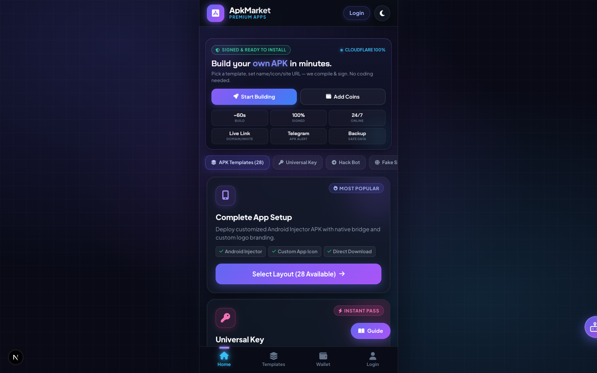
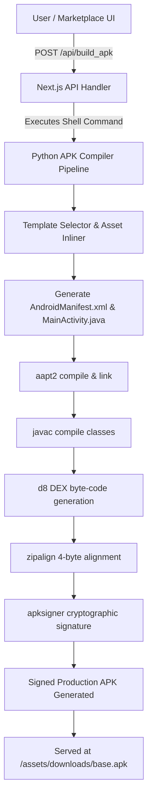

# 📱 APK Market: Automated Web-to-APK Compiler & Marketplace Platform

> **The definitive Windows-preferred full clone and automated compilation engine of APK Market.** Build, customize, and sign interactive Android WebView APKs with embedded floating HUD overlay templates, live period tracking, and headless Android toolchain integration.

[](https://nextjs.org/)
[](https://react.dev/)
[](https://python.org/)
[](https://developer.android.com/studio)
[](https://microsoft.com)
[](LICENSE)

---

## 📸 Showcase & Preview



*Desktop Marketplace Interface with dynamic order processing, live preview cards, and automated APK generation.*

---

## ⚡ Highlights & Overview

This repository provides an enterprise-ready, **1:1 full clone** of the popular APK Market platform (`apkmarket.auto`). It couples a high-performance **Next.js 16 + React 19** dark-mode marketplace with an automated, headless **Python 3 Android APK Compiler** pipeline. 

### Why Windows Preferred?
While the compiler supports macOS and Linux natively, this pipeline is **engineered specifically for Windows environments** where enterprise command-line Android build-tools, batch pipelines, and automated kiosk kiosks are predominantly deployed.

### Core Capabilities:
- 🚀 **Zero-Gradle Headless APK Compilation**: Uses native command-line build tools (`aapt2`, `javac`, `d8`, `zipalign`, `apksigner`) to produce signed, production-ready APKs in **under 3 seconds**.
- 🎮 **5 Cyberpunk & Gaming Floating HUDs**: Fully animated floating mini FAB icons that expand into interactive control panels on top of any target web application.
- 🔄 **Real-Time Data Bridge**: Scrapes and synchronizes target URL balance, session parameters, and period states, with optional Firebase Realtime Database integration.
- 🌐 **Legacy PHP API Routing**: Built-in Next.js App Router endpoints matching legacy PHP paths (`/order.php`, `/checkout.php`, `/login.php`, `/register.php`, `/verify_image.php`, `/ai_chat_api.php`, `/bot_order.php`).
- 🛡️ **Autonomous Keystore & Signing**: Automatically creates 2048-bit RSA keystores, applies custom `dname` metadata, zipaligns to 4-byte boundaries, and cryptographically signs with v1/v2/v3 Android signatures.

---

## 🎨 Available Overlay Templates

| Template | Design ID | Visual Theme | Key Features |
| :--- | :---: | :--- | :--- |
| **CYBER PANEL** | `4` / `CYBER PANEL` | Purple Neon Cyberpunk | Orbital scanner, EMP shockwave, PING & Period tracker, Drag & Tap engine, HIDE toggle |
| **GALAXY VISION** | `1` / `GLAXY VISION` | Deep Space Cyan & Blue | Dual laser ring perimeter, high-precision predictive bar, multi-state balance sync |
| **APEX WINGS MOD** | `2` / `APEX WINGS` | Golden Cyber Wings | Neon wing span animations, dual trigger buttons, compact HUD |
| **APEX PANEL** | `3` / `APEX PANEL` | Modern Glassmorphism | Hexagonal data layout, low-latency ping indicator, tactile touch buttons |
| **TRANSFORMER V1** | `0` / `TRANSFORMER` | Mecha Gold & Red | Industrial mecha aesthetic, audio-reactive pulses, high-contrast period display |

---

## 🏗️ Architecture & Workflow



---

## 💻 Setup Guide (Windows Preferred)

Follow this step-by-step guide to run the complete marketplace and Android compiler locally on **Windows 10 / 11**.

### 1. Prerequisites Installation

1. **Install Node.js (v20+ or v22 LTS)**:
   - Download from [nodejs.org](https://nodejs.org/).
   - Ensure `Add to PATH` is checked during installation.
2. **Install Python 3.10+**:
   - Download from [python.org](https://www.python.org/downloads/windows/).
   - **Crucial**: Check the box **"Add Python to PATH"** on the first setup screen.
3. **Install OpenJDK 17 or 21**:
   - Download Eclipse Temurin or Microsoft OpenJDK: [Adoptium Temurin 17](https://adoptium.net/).
4. **Install Android Command-line Tools (or Android Studio)**:
   - If using Android Studio: Install SDK Platforms (API 34 or 35) and Android SDK Build-Tools (e.g., version `35.0.0` or `34.0.0`).
   - SDK is installed by default at:
     ```text
     C:\Users\<YourUsername>\AppData\Local\Android\Sdk
     ```

### 2. Environment Variables Configuration

Open Windows PowerShell as Administrator and configure your environment variables:

```powershell
# Set ANDROID_HOME
[System.Environment]::SetEnvironmentVariable("ANDROID_HOME", "C:\Users\$env:USERNAME\AppData\Local\Android\Sdk", "User")

# Add Build-Tools and Platform-Tools to PATH
$buildTools = "C:\Users\$env:USERNAME\AppData\Local\Android\Sdk\build-tools\35.0.0"
$platformTools = "C:\Users\$env:USERNAME\AppData\Local\Android\Sdk\platform-tools"
$currentPath = [System.Environment]::GetEnvironmentVariable("Path", "User")
[System.Environment]::SetEnvironmentVariable("Path", "$currentPath;$buildTools;$platformTools", "User")
```

Verify your installation:
```cmd
aapt2 version
d8 --version
zipalign --help
apksigner --version
java -version
python --version
```

### 3. Clone and Install Dependencies

```bash
git clone https://github.com/<your-username>/apk-market-clone.git
cd apk-market-clone

# Install frontend dependencies
npm install
```

### 4. Running the Development Server

```bash
npm run dev
```

Open your browser at **`http://localhost:3000`** to interact with the full marketplace.

---

## 🍎 Setup Guide (macOS & Linux)

For macOS and Linux developers:

```bash
# 1. Ensure Android SDK build tools are in your PATH (e.g. in ~/.zshrc or ~/.bashrc)
export ANDROID_HOME=$HOME/Library/Android/sdk
export PATH=$PATH:$ANDROID_HOME/build-tools/35.0.0:$ANDROID_HOME/platform-tools

# 2. Install dependencies
npm install

# 3. Start development server
npm run dev
```

---

## ⚙️ CLI Compilation Guide

You can run the standalone compiler directly from your terminal:

```bash
python apk_compiler.py <TARGET_WEBSITE_URL> <APP_NAME> <DESIGN_ID> <OUTPUT_PATH> <PACKAGE_NAME>
```

### Example: Compiling Cyber Panel
```bash
python apk_compiler.py "https://example.com" "CYBER VIP" "CYBER PANEL" "public/assets/downloads/cyber.apk" "com.cyber.vip"
```

### Example: Compiling Galaxy Vision
```bash
python apk_compiler.py "https://example.com" "GALAXY MOD" "GLAXY VISION" "public/assets/downloads/galaxy.apk" "com.galaxy.app"
```

---

## 📡 REST API Reference

### Build Custom APK
- **Endpoint**: `POST /api/build_apk`
- **Content-Type**: `application/json`

#### Request Payload:
```json
{
  "websiteUrl": "https://tamilwin33.com/",
  "appName": "TAMILWIN VIP",
  "designId": "CYBER PANEL",
  "packageName": "com.tamilwin33.app"
}
```

#### Response:
```json
{
  "success": true,
  "downloadUrl": "/assets/downloads/base.apk",
  "appName": "TAMILWIN VIP",
  "websiteUrl": "https://tamilwin33.com/",
  "packageName": "com.tamilwin33.app"
}
```

---

## 📂 Project Structure

```text
├── src/
│   ├── app/
│   │   ├── api/
│   │   │   └── build_apk/route.ts       # Automated Next.js compilation API
│   │   ├── checkout.php/page.tsx        # Checkout and payment gateway screen
│   │   ├── order.php/page.tsx           # Order details and status screen
│   │   ├── login.php/page.tsx           # User authentication
│   │   ├── register.php/page.tsx        # Registration flow
│   │   ├── ai_chat_api.php/route.ts     # Customer support AI assistant API
│   │   ├── page.tsx                     # Marketplace Home UI
│   │   └── globals.css                  # Tailored Cyberpunk styles
├── public/
│   ├── assets/
│   │   ├── downloads/                   # Compiled Android APK store
│   │   └── images/                      # High-res logos & HUD icons
│   └── processed_body.html              # Extracted live marketplace layout
├── docs/
│   └── screenshots/                     # Preview images & documentation assets
├── apk_compiler.py                      # Headless Python Android compiler engine
├── template_0_TRANSFORMER_V1.html       # Transformer V1 HUD overlay
├── template_1_GLAXY_VISION.html         # Galaxy Vision HUD overlay
├── template_2_APEX_WINGS_MOD.html       # Apex Wings HUD overlay
├── template_3_APEX_PANEL.html           # Apex Panel HUD overlay
├── template_4_CYBER_PANEL.html          # Cyber Panel HUD overlay
├── package.json                         # Next.js 16 dependencies & scripts
└── tsconfig.json                        # TypeScript configuration
```

---

## 🔍 SEO & Metadata Index

- **Keywords**: `apk-market-clone`, `web-to-apk-compiler`, `headless-android-builder`, `windows-apk-compiler`, `nextjs-apk-marketplace`, `cyberpunk-hud-overlay`, `android-webview-mod`, `apksigner-automation`, `react-19-marketplace`
- **Use Cases**: Custom WebView wrapping, client branded web apps, live casino & gaming prediction overlays, instant Android prototyping, automated enterprise app packaging.

---

## 📄 License & Attribution

This project is licensed under the **MIT License**. Created for educational, prototyping, and reverse-engineering research purposes.
